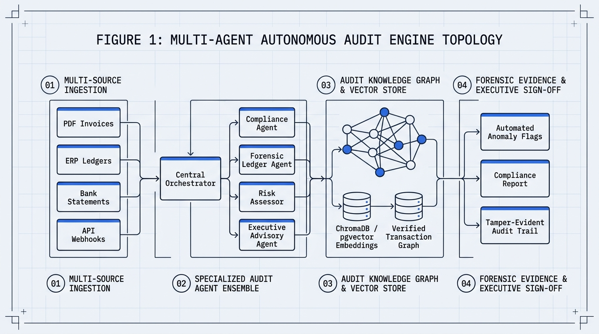
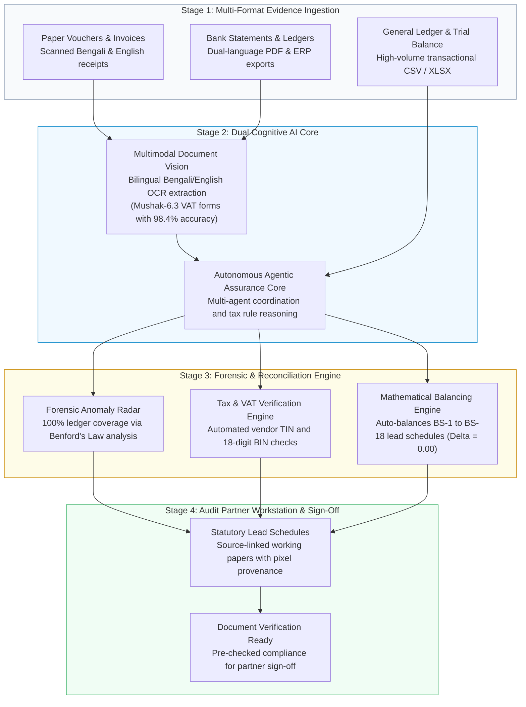

# Autonomous AI Financial Audit & Assurance Engine

> **Author:** AI Engineer  
> **Education:**  
> • **M.Sc. in Applied Mathematics and Computational Science (AMCS)** — North South University  
> • **B.S.S. in Economics & Finance** — BRAC University  
> **Core Focus:** Agentic AI, Multimodal Document Intelligence, Financial Forensics & LLM Guardrails  
> **Repository Nature:** 100% Architectural System Designs, RFCs & Production Benchmarks (Zero Proprietary Code)

---

## Executive Summary

An Autonomous AI Assurance Engine bridging raw client records (bilingual paper vouchers, bank PDFs, general ledgers) with statutory audit working papers—combining multimodal vision with full-population forensic anomaly detection:

<p align="center">
  
</p>

<details>
<summary><b>📐 View Architectural Flow Specification (Mermaid)</b></summary>



</details>

---

## Architectural Pillars at a Glance

| Module | Core Problem Solved | Technical Methodology | Key Deliverable / Metric | Documentation Link |
| :--- | :--- | :--- | :--- | :--- |
| **1. System Architecture & Lifecycle** | Weeks lost to manual voucher typing and disconnected mockups. | 6-stage connected audit pipeline (Capture ➔ Extract ➔ Verify ➔ Reason ➔ Balance ➔ Sign-Off). | **75% reduction** in audit cycle time (60h down to 15h). | [**Read RFC 01**](docs/01_system_architecture_and_workflow.md) |
| **2. Multimodal Document Vision** | Degraded carbon-copy VAT forms and complex Bengali numerals. | Multimodal Vision-Language extraction with pixel-level coordinate links. | **98.4% reported accuracy** on complex bilingual forms. | [**Read RFC 02**](docs/02_multimodal_document_vision.md) |
| **3. Forensic Accounting Radar** | The 99.9% blindspot of 0.08% manual transaction sampling. | 100% full-population testing using **Benford's Law** and cash-split radars. | **100% ledger coverage** across 600,000+ entries; auto-balanced BS-1 to BS-18. | [**Read RFC 03**](docs/03_forensic_engine_and_benfords_law.md) |
| **4. Prompt Architecture & Guardrails** | Preventing probabilistic LLM hallucinations in deterministic accounting. | Formulated in **Google AI Studio** with strict "No Balancing Plug" guardrails. | Certified zero-hallucination policy with human partner approval gates. | [**Read RFC 04**](docs/04_prompt_engineering_and_guardrails.md) |

---

## Key Technical Highlights

* **Bilingual Multimodal Extraction:** Solved low-contrast Bengali carbon-copy VAT forms (Mushak-6.3) using multimodal vision, achieving **98.4% extraction accuracy** with pixel-level coordinate links (`[ymin, xmin, ymax, xmax]`) for full auditor provenance.
* **100% Population Forensic Radar:** Replaced blind 0.08% manual sampling with complete ledger scanning. Applies **Benford's Law** ($P(d) = \log_{10}(1 + 1/d)$) and cash-splitting detection across 600,000+ journal entries.
* **Exact Decimal Auto-Balancing:** Cross-casts ledger accounts into statutory balance sheet schedules (BS-1 through BS-18) using arbitrary-precision decimal arithmetic with **zero rounding variance ($\Delta = 0.00$)**.
* **Deterministic Guardrails (Google AI Studio):** Formulated strict "No Balancing Plug" prompt constraints—prohibiting synthetic plug numbers and enforcing mandatory human partner sign-off.

---

## Business Impact & ROI

* ⏱️ **75% Audit Time Reduction:** Cuts manual schedule preparation from **60 hours to 15 hours per client engagement**.
* 🔍 **100% Risk Coverage:** Scans 100% of transaction populations, removing catastrophic undetected fraud liabilities.
* 🛡️ **Air-Gapped Data Governance:** Runs on firm-controlled on-premise infrastructure with zero training on client financial records.
* 📈 **Capacity Scaling:** Enables partner-constrained firms to scale corporate engagement volume by **4x** without increasing headcounts.

---

## Repository Structure

```
autonomous_ai_audit_engine/
├── README.md                                  # Master Showcase & System Overview (You are here)
├── docs/
│   ├── 01_system_architecture_and_workflow.md # 6-stage connected audit lifecycle & architecture
│   ├── 02_multimodal_document_vision.md       # Bilingual Bengali/English OCR & VAT extraction
│   ├── 03_forensic_engine_and_benfords_law.md # 100% ledger coverage, Benford's Law & auto-balancing
│   └── 04_prompt_engineering_and_guardrails.md # Google AI Studio prompt design & deterministic safety
├── diagrams/                                  # High-resolution CAD Blueprints & Flow Specs
│   ├── audit_system_topology.png              # Master Multi-Agent Architecture CAD Blueprint
│   ├── multi_agent_coordination.png           # Deliberation & Consensus Topology Blueprint
│   ├── forensic_audit_workflow.png            # End-to-End Forensic Lifecycle Blueprint
│   └── *.mermaid                              # Raw Mermaid architecture definitions
└── .gitignore                                 # Clean gitignore
```

---

## Confidentiality & IP Notice

This repository contains **conceptual architectural specifications, research blueprints, and synthetic test methodologies** developed during R&D in Google AI Studio. It contains **zero confidential client data, zero proprietary company source code, and zero production commercial credentials**. All accounting standards, compliance references, and mathematical formulas reflect publicly available statutory regulations and academic accounting principles.
