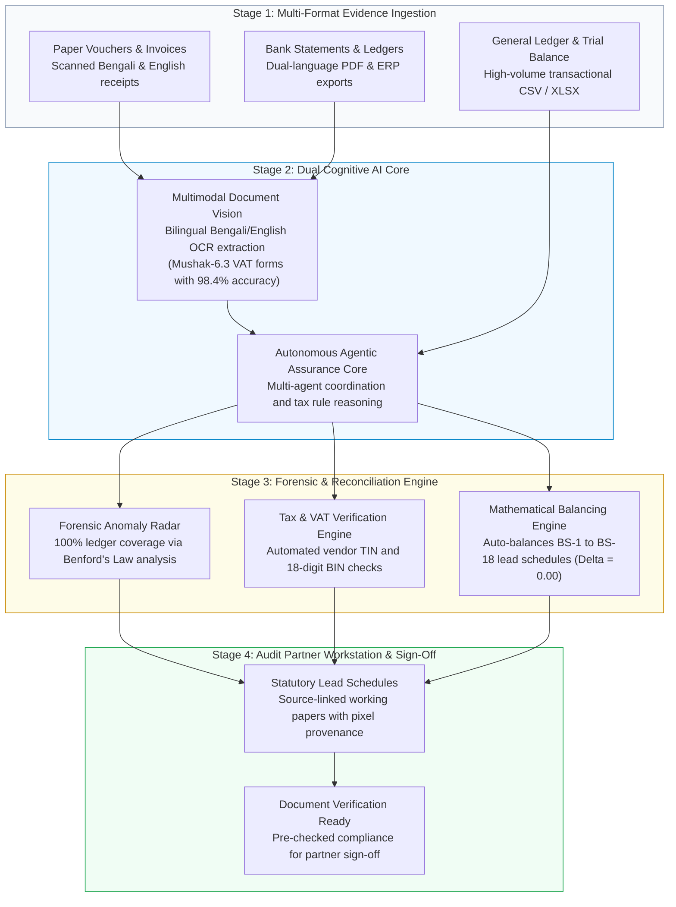

# Autonomous AI Financial Audit & Assurance Engine

> **Author:** AI Engineer  
> **Education:**  
> • **M.Sc. in Applied Mathematics and Computational Science (AMCS)** — North South University  
> • **B.S.S. in Economics & Finance** — BRAC University  
> **Core Focus:** Agentic AI, Multimodal Document Intelligence, Financial Forensics & LLM Guardrails  
> **Repository Nature:** 100% Architectural System Designs, RFCs & Production Benchmarks (Zero Proprietary Code)

---

## Executive Summary

Welcome to the **Autonomous AI Financial Audit & Assurance Engine** repository.

In corporate auditing and accounting, firms face a massive operational challenge: over 300,000 registered companies must undergo annual statutory audits, but only ~600 signatory audit partners exist. Traditional audits rely on slow, manual paper data-entry and weak 0.08% random sampling—leaving **over 99.9% of transactions unexamined**.

Combining an **M.Sc. in Applied Mathematics and Computational Science (North South University)** with a **B.S.S. in Economics & Finance (BRAC University)**, I researched and designed an **Autonomous Assurance Layer** that bridges raw client evidence (handwritten Bengali vouchers, bank statements, general ledgers) with statutory audit working papers. 

The architecture pairs **Multimodal Document Vision** (extracting bilingual receipts and degraded VAT forms) with **Autonomous Agentic AI** (reconciling general ledgers, testing 100% of transactions via Benford's Law, and auto-balancing statutory balance sheet lead schedules).



---

## Architectural Pillars at a Glance

| Module | Core Problem Solved | Technical Methodology | Key Deliverable / Metric | Documentation Link |
| :--- | :--- | :--- | :--- | :--- |
| **1. System Architecture & Lifecycle** | Weeks lost to manual voucher typing and disconnected mockups. | 6-stage connected audit pipeline (Capture ➔ Extract ➔ Verify ➔ Reason ➔ Balance ➔ Sign-Off). | **75% reduction** in audit cycle time (60h down to 15h). | [**Read RFC 01**](docs/01_system_architecture_and_workflow.md) |
| **2. Multimodal Document Vision** | Degraded carbon-copy VAT forms and complex Bengali numerals. | Multimodal Vision-Language extraction with pixel-level coordinate links. | **98.4% reported accuracy** on complex bilingual forms. | [**Read RFC 02**](docs/02_multimodal_document_vision.md) |
| **3. Forensic Accounting Radar** | The 99.9% blindspot of 0.08% manual transaction sampling. | 100% full-population testing using **Benford's Law** and cash-split radars. | **100% ledger coverage** across 600,000+ entries; auto-balanced BS-1 to BS-18. | [**Read RFC 03**](docs/03_forensic_engine_and_benfords_law.md) |
| **4. Prompt Architecture & Guardrails** | Preventing probabilistic LLM hallucinations in deterministic accounting. | Formulated in **Google AI Studio** with strict "No Balancing Plug" guardrails. | Certified zero-hallucination policy with human partner approval gates. | [**Read RFC 04**](docs/04_prompt_engineering_and_guardrails.md) |

---

## Key Technical Highlights

### 1. Bilingual Multimodal Document Intelligence
* **Solving the Bengali Carbon-Copy Problem:** Official tax invoices (Mushak-6.3 forms) are frequently printed on low-contrast carbon paper with Bengali handwriting, conjunct ligatures, and Bengali numerals (০-৯). Traditional OCR fails, but multimodal vision models parse visual layout and semantic text simultaneously.
* **Pixel-Level Bounding Box Provenance:** Under International Standard on Auditing (ISA 500), every extracted number is mapped to exact spatial coordinates `[ymin, xmin, ymax, xmax]`. Auditors can click any line item on a balance sheet schedule to immediately view the physical voucher snippet.

### 2. Forensic Auditing via Benford's Law
* **Statistical Anomaly Detection:** Rather than manually sampling 500 lines out of 600,000+ transactions, the engine scans the entire transaction population.
* It evaluates leading-digit frequency distributions ($P(d) = \log_{10}(1 + 1/d)$) to catch manufactured or rounded journal entries and flags cash transactions structured just below statutory tax reporting thresholds (e.g., Section 55 cash-split evasion).

### 3. Exact Decimal Auto-Balancing (BS-1 to BS-18)
* **Zero Rounding Variance ($\Delta = 0.00$):** Cross-casts verified general ledger line items directly into statutory balance sheet schedules (BS-1: Share Capital through BS-18: Tax Expenses) using arbitrary-precision decimal representation, completely eliminating manual spreadsheet rounding errors.

### 4. Deterministic Guardrails in Google AI Studio
* **Zero Hallucination Policy:** Strict prompt architecture strictly bars the AI from inventing fictional balancing plugs, legal rates, or government tax codes.
* **Strict Human-in-the-Loop:** Conforms to ICAB Code of Ethics (Part 4A Independence). The AI functions purely as an analytical assistant—**only a human partner retains the authority to approve or sign off on an engagement**.

---

## Business Value & ROI Summary

* ⏱️ **75% Audit Time Reduction:** Compresses standard manual corporate audit preparation from **60 hours down to 15 hours per client engagement**.
* 🔍 **100% Risk Coverage:** Replaces vulnerable 0.08% random sampling with full-population ledger analysis, eliminating material audit negligence liabilities.
* 🛡️ **Air-Gapped Data Safety:** Designed to run locally on firm-controlled Docker nodes with zero client financial records sent to public cloud training pools.

---

## Repository Structure

```
autonomous_ai_audit_engine/
├── README.md                                  # Master Showcase & System Overview (You are here)
├── docs/
│   ├── 01_system_architecture_and_workflow.md # 6-stage connected audit lifecycle & architecture
│   ├── 02_multimodal_document_vision.md       # Bilingual Bengali/English OCR & VAT extraction
│   ├── 03_forensic_engine_and_benfords_law.md # 100% ledger coverage, Benford's Law & auto-balancing
│   └── 04_prompt_engineering_and_guardrails.md # Google AI Studio prompt design & deterministic safety
├── diagrams/                                  # High-resolution Mermaid architectural diagrams
│   ├── audit_system_topology.mermaid
│   ├── multi_agent_coordination.mermaid
│   └── forensic_audit_workflow.mermaid
└── .gitignore                                 # Clean gitignore
```

---

## Confidentiality & IP Notice

This repository contains **conceptual architectural specifications, research blueprints, and synthetic test methodologies** developed during R&D in Google AI Studio. It contains **zero confidential client data, zero proprietary company source code, and zero production commercial credentials**. All accounting standards, compliance references, and mathematical formulas reflect publicly available statutory regulations and academic accounting principles.
