# System Architecture: Autonomous Financial Audit & Assurance Engine

> **Role:** AI Engineer  
> **Tech Stack:** Python, Node.js, TypeScript, React, Google Gemini / Multimodal LLMs, SQLite / PostgreSQL  
> **Domain:** Statutory Financial Audit, Regulatory Tax Compliance & Multi-Agent AI Systems

---

## 1. Industry Context: The Audit Capacity Bottleneck

In corporate financial auditing, professional audit firms (Chartered Accountants) face an overwhelming capacity crisis:
* **The Volume Mismatch:** Over 300,000 registered commercial entities must undergo annual statutory audits, yet there are only ~600 licensed signatory audit partners.
* **The Broken Manual Assembly Line:** Junior audit staff spend 2 to 3 weeks per engagement manually typing paper vouchers, scanning faded receipts, cross-checking tax numbers, and copying journal entries into spreadsheets.
* **The 0.08% Blindspot:** Because manual entry is slow, audit firms are forced to rely on tiny random samples (testing roughly 500 lines out of 600,000+ general ledger entries). Over **99.9% of financial transactions go completely unverified**, leaving audit partners exposed to undetected corporate fraud and regulatory compliance penalties.

This project delivers an **Autonomous AI Assurance Layer** that sits between raw client records (paper vouchers, bank PDFs, and general ledgers) and final statutory audit working papers.

```mermaid
flowchart LR
    S1["Stage 1: Capture<br>Raw Evidence Ingestion"] --> S2["Stage 2: Extract<br>Multimodal Vision OCR"]
    S2 --> S3["Stage 3: Verify<br>Statutory Tax Compliance"]
    S3 --> S4["Stage 4: Reason<br>100% Forensic Ledger Radar"]
    S4 --> S5["Stage 5: Balance<br>Auto-Balancing Lead Schedules"]
    S5 --> S6["Stage 6: Sign-Off<br>Partner Review & Verification Ready"]

    style S1 fill:#f8fafc,stroke:#94a3b8,stroke-width:1px
    style S2 fill:#f0f9ff,stroke:#0284c7,stroke-width:1px
    style S3 fill:#fefce8,stroke:#ca8a04,stroke-width:1px
    style S4 fill:#fff7ed,stroke:#ea580c,stroke-width:1px
    style S5 fill:#eff6ff,stroke:#2563eb,stroke-width:1px
    style S6 fill:#f0fdf4,stroke:#16a34a,stroke-width:1px
```

---

## 2. The Six-Stage Connected Audit Flow

The architecture automates routine data-entry and cross-checking while preserving strict auditor control across six connected stages:

1. **Stage 1 (Capture - Evidence Ingestion):** Ingests physical paper vouchers, scanned invoices, bank statements, and ERP trial balances into a secure local repository.
2. **Stage 2 (Extract - Multimodal Vision):** Uses multimodal vision models to extract structured data from challenging bilingual documents (including handwritten Bengali receipts and degraded carbon-copy VAT forms) with high OCR fidelity.
3. **Stage 3 (Verify - Regulatory Compliance):** Automatically validates vendor Tax Identification Numbers (TIN), 18-digit Business Identification Numbers (BIN), and withholding tax compliance (TDS/VDS rules) against statutory thresholds.
4. **Stage 4 (Reason - Forensic Ledger Radar):** Analyzes 100% of general ledger transactions using statistical anomaly models (including Benford's Law) and flags structured cash payments designed to evade tax caps.
5. **Stage 5 (Balance - Mathematical Schedule Reconciliation):** Automatically maps ledger balances into statutory lead schedules (BS-1 to BS-18) using exact decimal arithmetic to ensure zero mathematical rounding errors ($\Delta = 0.00$).
6. **Stage 6 (Sign-Off - Partner Review Readiness):** Packages all verified schedules with pixel-level document links, preparing the audit file for the engagement partner's final independent sign-off.

---

## 3. Data Sovereignty & On-Premise Safety

Professional audit firms handle strictly confidential corporate financial records. Standard public cloud AI models (which send data over public APIs or train on user inputs) are legally unacceptable under professional accounting codes of conduct.

The architecture was designed with strict **Data Privacy & Governance Guardrails**:
* **On-Premise Deployment:** Configured to run within a firm-controlled local containerized environment. General ledgers and private transactions never leave the company's internal network perimeter.
* **Zero Model Training:** Explicit contractual safeguards ensure client records are purged from memory immediately after schedule generation and are never used to train or fine-tune public AI models.
* **Professional Independence Standards:** Aligned with the International Code of Ethics for Professional Accountants. The AI functions purely as an analytical assistant—**the AI cannot approve or close an engagement on its own**, ensuring the licensed auditor maintains complete legal autonomy.

---

## 4. Measurable Business & Operational Impact

* **75% Time Reduction:** Compresses routine audit preparation time from **60 hours down to 15 hours per corporate engagement**, freeing senior auditors to focus on high-risk forensic investigations and client advisory.
* **Elimination of Sampling Risk:** Shifts firms from blind 0.08% manual sampling to **100% full-population testing**, providing complete audit coverage across hundreds of thousands of transactions.
* **Audit File Traceability:** Every extracted financial figure maintains an permanent mathematical lineage and pixel-level bounding-box link back to the original source voucher.
