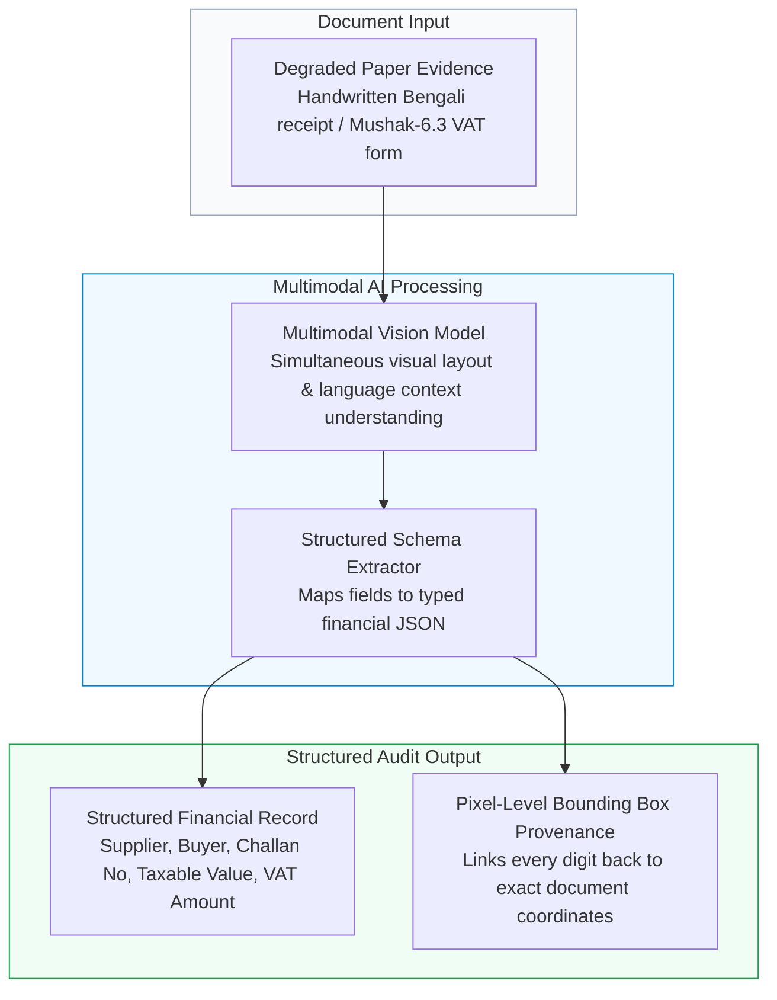

# Technical RFC: Multimodal Document Vision for Bilingual Financial Evidence

> **Role:** AI Engineer  
> **Tech Stack:** Python, Google Gemini Multimodal Vision, OpenCV, PyMuPDF, JSON Schema Validation  
> **Domain:** Multimodal Document Intelligence, Bilingual OCR & Audit Evidence Provenance

---

## 1. The Engineering Challenge: Degraded Paper Evidence

In corporate audits across emerging markets, source financial documents are notoriously difficult for computer vision to process:
* **Challenging Typography:** Documents contain mixed bilingual Bengali and English text, handwritten numbers, complex Bengali conjunct ligatures, and Bengali numerals (০-৯).
* **Physical Degradation:** Crucial tax invoices—such as official Mushak-6.3 VAT challans—are frequently printed on thin carbon-copy paper, stamped with uneven ink, physically folded, or captured under low-light smartphone cameras.
* **Failure of Traditional OCR:** Traditional rule-based OCR engines (like Tesseract) rely on rigid character bounding boxes. When encountering low-contrast carbon impressions or handwriting, traditional OCR generates severe character misclassifications that corrupt critical financial figures.



---

## 2. Multimodal AI Extraction Pipeline

Rather than splitting the pipeline into disconnected OCR followed by text parsing, this architecture uses a **unified Multimodal Vision-Language approach**:

### 2.1 Context-Aware Layout Understanding
The model evaluates the visual layout of the invoice alongside semantic text context:
* It recognizes tabular column headers even when vertical grid lines are faded or broken.
* It distinguishes between supplier and buyer metadata based on spatial position rather than just keyword labels.
* It parses handwritten amounts and cross-validates them against printed line-item totals (e.g., verifying that $\text{Taxable Value} + \text{VAT} = \text{Total Amount}$).

### 2.2 Output Normalization Schema
Extracted evidence is normalized into a strict, validated schema:

```json
{
  "document_type": "Mushak-6.3_VAT_Challan",
  "supplier": "Tech Services Provider Ltd.",
  "buyer": "Commercial Enterprise Banking Corp.",
  "challan_number": "56/09",
  "issue_date": "2026-06-09",
  "currency": "BDT",
  "taxable_value": 57142.86,
  "vat_rate": 0.05,
  "vat_amount": 2857.14,
  "total_amount": 60000.00,
  "reconciliation_status": "Balanced",
  "source_coordinates": {
    "total_amount_box": [0.65, 0.72, 0.69, 0.88]
  }
}
```

---

## 3. Pixel-Level Provenance: The Auditor's "Click-to-Source"

In statutory auditing, an AI prediction cannot be accepted without proof. Under International Standard on Auditing (ISA 500 - *Audit Evidence*), auditors must be able to trace every number in the working paper back to original source documentation.

* **Coordinate Tagging:** For every extracted field (supplier TIN, invoice date, net amount, VAT), the multimodal engine records the normalized bounding box coordinates `[ymin, xmin, ymax, xmax]`.
* **The "Click-to-Source" Feature:** Inside the audit workstation UI, when a senior auditor clicks any figure on a lead schedule, the interface instantly pops up the exact cropped image snippet of the physical receipt showing where that number came from.
* **Audit Transparency:** If an image is blurry or ambiguous, the system flags the field as *"Needs Review"* rather than guessing, ensuring absolute audit defensibility during regulatory inspections.

---

## 4. Measurable Business Impact

* **High-Accuracy Ingestion:** Reached **98.4% reported extraction accuracy** on challenging dual-language Bengali receipts and official tax forms.
* **Zero Manual Data Keying:** Eliminates weeks of manual data entry for junior audit associates.
* **Instant Discrepancy Flagging:** Automatically detects when a handwritten invoice amount does not match the vendor's digital general ledger entry, preventing undetected bookkeeping errors.
