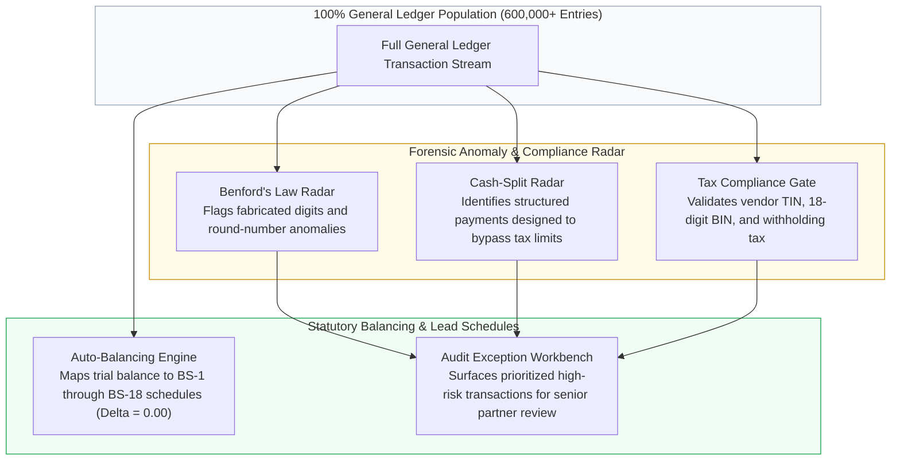

# Technical RFC: Forensic Accounting Engine, Benford's Law Radar & Auto-Balancing

> **Role:** AI Engineer  
> **Tech Stack:** Python, Pandas, NumPy, Scipy, SQLite, Decimal Arithmetic  
> **Domain:** Forensic Accounting, Statistical Anomaly Detection & Statutory Lead Schedules

---

## 1. Beyond 0.08% Sampling: The Power of 100% Population Audits

Traditional audit practice relies on statistical random sampling:
* An enterprise client produces **600,000+ General Ledger (GL) lines** per fiscal year.
* A human audit team only has the capacity to manually vouch approximately **500 transaction lines (a 0.08% sample)**.
* **The Vulnerability:** Fraudulent transactions, fictitious vendor payments, and tax-evading expense splits never occur randomly. They are deliberately hidden among low-visibility routine transactions. If an auditor samples 0.08%, there is a **99.92% probability that a fraudulent transaction remains completely unseen**.

This engine eliminates sampling blindspots by running automated analytical procedures across **100% of the transaction population**.

---

## 2. Benford's Law Radar: Catching Fabricated Journal Entries

Benford’s Law states that in naturally occurring financial datasets, the leading first digit $d \in \{1, 2, \dots, 9\}$ follows a predictable logarithmic probability distribution:

$$P(d) = \log_{10}\left(1 + \frac{1}{d}\right)$$

| Leading Digit | Expected Natural Probability |
| :---: | :---: |
| **1** | **30.1%** |
| **2** | **17.6%** |
| **3** | **12.5%** |
| **4** | **9.7%** |
| **5** | **7.9%** |
| **6** | **6.7%** |
| **7** | **5.8%** |
| **8** | **5.1%** |
| **9** | **4.6%** |

### How Fraudsters Deviate from the Law:
When employees or rogue bookkeepers invent fake expenses, fabricate invoices, or manually tamper with accounts, they do not invent numbers that follow Benford's distribution. Instead, human intuition tends to pick random numbers uniformly or repeatedly use "safe-looking" rounded amounts (e.g., invoices starting with 5, 8, or 9).

* **The Engine's Action:** Scans all 600,000+ transaction amounts across the entire year, computes the leading-digit frequency distribution, and performs a Chi-Square goodness-of-fit test against Benford’s theoretical distribution.
* **Result:** Instantly flags accounts and vendors exhibiting statistically significant spikes in unusual leading digits, surfacing high-risk review priorities for the audit team.

---

## 3. Cash-Split & Regulatory Tax Evasion Radar

Under corporate tax regulations (such as Section 55 of the Income Tax Act), cash payments exceeding statutory thresholds (e.g., BDT 50,000) are subject to mandatory tax deduction at source (TDS) and require electronic banking transfers.

* **The Evasion Scheme:** Businesses attempting to bypass this rule intentionally split a single large payment (e.g., BDT 140,000) into three consecutive cash vouchers of BDT 48,000, 47,000, and 45,000 on the same date or across consecutive days to the same recipient.
* **The Radar:** The forensic engine groups ledger transactions by vendor ID and timestamp proximity, automatically flagging clusters of transactions that sit just below the statutory reporting cap.

---

## 4. Auto-Balancing Statutory Lead Schedules (BS-1 to BS-18)

Once transactions are audited and verified, they must be organized into statutory balance sheet lead schedules:
* **The Manual Bottleneck:** In traditional audits, junior accountants spend hours cross-casting, summing debit and credit balances, and manually hunting for small rounding errors between Trial Balances and statutory financial statement drafts.
* **Exact Decimal Arithmetic:** Using arbitrary-precision decimal representation, the engine automatically maps verified general ledger accounts directly into standard balance sheet schedules (**BS-1: Share Capital** through **BS-18: Tax Expenses**).
* **Guaranteed Balance:** Mathematically cross-casts all line items, ensuring an exact zero difference:

$$\Delta = \text{Assets} - (\text{Liabilities} + \text{Equity}) = \mathbf{0.00}$$

---

## 5. Business Value & Risk Protection

* **Guaranteed Audit Quality:** Provides 100% ledger coverage, eliminating the legal risk that an audit partner signs off on a client with hidden material fraud.
* **Regulatory Inspection Defense:** When government regulatory oversight bodies inspect the audit working papers, every schedule is backed by comprehensive mathematical proof and digital audit trails.
* **Hours Saved:** Replaces days of manual schedule cross-casting with instant, automated reconciliation.
