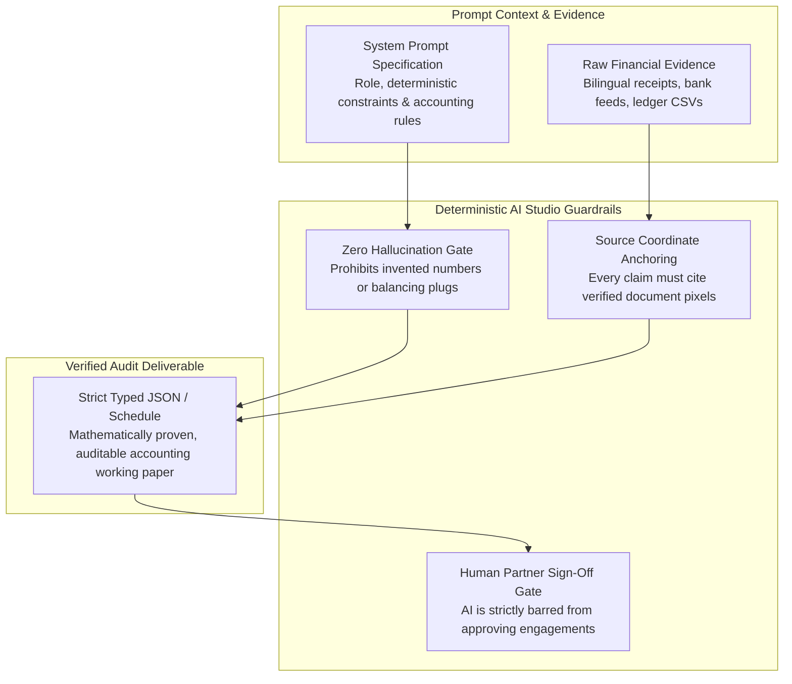

# Technical RFC: Prompt Architecture & Deterministic Guardrails in Google AI Studio

> **Role:** AI Engineer  
> **Tech Stack:** Google AI Studio, Google Gemini (Pro / Flash), Prompt Engineering, TypeScript, Structured JSON Output  
> **Domain:** Generative AI Architecture, Financial Determinism & Regulatory Safety Guardrails

---

## 1. R&D in Google AI Studio: Designing for Deterministic Finance

Large Language Models (LLMs) are inherently probabilistic, whereas statutory financial accounting is strictly deterministic. In corporate accounting, an AI cannot be allowed to round numbers loosely, invent balancing plugs, or guess tax rates.

During research and development in **Google AI Studio**, this project formulated a robust **Prompt Architecture and Safety Guardrail Framework**. The architecture transforms multimodal LLMs into disciplined, deterministic analytical engines capable of guiding auditors through complex statutory workflows.

---

## 2. Core Guardrail Formulations

### Guardrail 1: The "No Fictional Balancing Plug" Rule
In manual bookkeeping, careless accountants sometimes insert a "plug" (an arbitrary unexplained journal adjustment) to force the debit and credit sides of a trial balance to match.
* **The Guardrail:** The system prompt strictly forbids the AI from synthesizing balancing entries:
  > *"Do not invent legal rates, government verification, DVC issuance, professional approval, or a balancing plug. If a schedule does not balance, calculate the exact residual difference $\Delta$, surface the underlying source transactions, and flag the account for auditor investigation."*

### Guardrail 2: Strict Mode Separation (Live vs. Fixture vs. Manual)
In enterprise software development, testing must never masquerade as real AI performance:
* **Live Extraction Mode:** Uses a valid server-side Gemini API key on synthetic client documents, labeling every field as unverified until reviewed by an auditor.
* **Fixture Mode:** When running offline without an API key, the system uses file-hash-matched test fixtures clearly labeled *"Sample extraction - simulated AI"*.
* **The Fail-Safe:** If an API provider fails or times out, the system must not silently substitute a pre-computed fixture and claim success. Lack of connectivity opens a transparent manual review workflow.

### Guardrail 3: Strict Autonomy Limits (Human-in-the-Loop)
Under statutory audit regulations, only licensed Chartered Accountants (Partners) can assume legal liability for an audit opinion.
* **The Guardrail:** The AI is architecturally restricted to an **advisory and analytical role**.
* The AI can extract, format, cross-cast, and flag anomalies, but **it cannot sign off, approve, or close an engagement**. All stage transitions require explicit, authenticated session actions from human preparers, managers, and partners.

---

## 3. Structured Persona & Role-Based Flow

To simulate a real accounting firm environment, the AI Studio specification structures user interactions across four distinct firm personas:

| Persona | System Permissions | Responsibilities |
| :--- | :--- | :--- |
| **Admin** | System configuration, client setup | Configures financial year, engagement scope, and local storage |
| **Preparer (Junior)** | Evidence upload, OCR review | Ingests vouchers, reviews OCR corrections, attaches ledger files |
| **Reviewer (Manager)** | Analytical review, exception resolution | Inspects Benford's Law alerts, audits cash splits, verifies lead schedules |
| **Partner** | Final sign-off, DVS readiness check | Reviews exceptions, verifies mathematical balance, signs statutory report |

---

## 4. Engineering Takeaways

* **Structured JSON Outputs:** Enforced JSON schema validation at inference time, ensuring responses adhere strictly to typed data contracts without conversational preamble.
* **Traceable Lineage:** Every explanation generated by the assistant is backed by explicit source voucher references and ledger line numbers.
* **Enterprise Credibility:** Demonstrates that modern AI engineering is not just about calling an API, but about **architecting strict deterministic guardrails, error handling, and regulatory compliance**.
